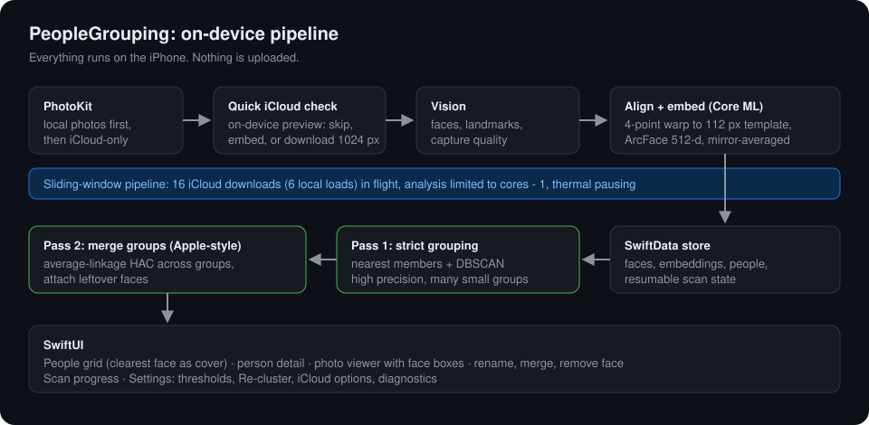

# iOS People Grouping

An on-device iOS demo that groups your photo library by person, like **People** in Apple Photos, Google Photos or Immich. It finds faces, recognises who is who, and clusters every photo of the same person into one group. Nothing leaves the phone.



## Features

- **Face detection** with Apple Vision (faces, landmarks and capture quality).
- **Face recognition** with an ArcFace-class Core ML model (512-dimensional embeddings, run on the Neural Engine).
- **Proper alignment**: each face is warped onto the standard 112 x 112 recognition template using both pupils and both mouth corners, and embedded together with its mirror image ("flip test").
- **Two-pass clustering**, modelled on Apple's published design:
  1. a strict first pass (nearest members + DBSCAN) that forms small, precise groups;
  2. an average-linkage hierarchical merge across groups that brings one person's different looks (glasses, lighting, angle, age) back into a single group, then attaches leftover faces.
- **iCloud Photos aware**: local photos are scanned first. For iCloud-only photos, a quick check of the copy already on the phone skips photos with no usable faces and embeds large faces directly; only photos with small faces are downloaded, at scan size (about 1024 px, never the original).
- **Fast and resumable**: a sliding-window pipeline keeps 16 iCloud downloads in flight while face analysis runs in parallel, with thermal pausing. Scans resume after the app is closed.
- **Editing**: rename people, merge two people, remove a wrong face (it is never put back), hide a person.
- **Tunable**: two sliders (strict match and group merging) and an instant Re-cluster that needs no rescan.
- **Diagnostics**: library breakdown (what is and is not scanned), per-stage timings, counts and logs.

## Requirements

- Xcode 27.2 or later, iOS 27.2 SDK.
- A real iPhone for meaningful results (the simulator has no real photo library).

## Getting started

1. Clone the repo and open `PeopleGrouping.xcodeproj`.
2. Download the face model into `PeopleGrouping/ML/` (about 120 MB; it is git-ignored on purpose):

   ```bash
   mkdir -p PeopleGrouping/ML
   curl -L https://huggingface.co/RuiSumida/AuraFace-v1-CoreML/resolve/main/FaceEmbedding.mlpackage.tar.gz | tar -xz -C PeopleGrouping/ML
   ```

   The source folder is synchronized, so Xcode picks the model up automatically. Without it the app still runs, using a much less accurate Vision feature-print fallback, and shows a warning in Settings.
3. Set your own bundle identifier (it ships as `com.example.peoplegrouping`) and your team under Signing & Capabilities.
4. Run on your iPhone, allow Photos access, and tap **Start Scan** on the Scan tab.

Build check from the command line:

```bash
xcodebuild build -project PeopleGrouping.xcodeproj -scheme PeopleGrouping -destination 'generic/platform=iOS' CODE_SIGNING_ALLOWED=NO
```

## Tuning the grouping

| If you see | Do this |
| --- | --- |
| One person split into several groups | Raise **Group merging** in Settings, then tap **Re-cluster** |
| Different people mixed in one group | Lower **Group merging** (and if needed **Match threshold**), then **Re-cluster** |
| A single wrong photo in a person | Long-press it and choose "Not this person" |

Re-cluster works from the stored face embeddings, so it takes seconds and reads no photos.

## How it works

| Stage | Implementation |
| --- | --- |
| Fetch | `PhotoLibraryService`: identifiers only, newest first, your own library (screenshots, videos, hidden photos and shared albums are not scanned) |
| Load | `requestImage` at 1024 px; on-device preview first for iCloud-only photos; exactly-once continuations with timeouts |
| Detect | `VNDetectFaceLandmarksRequest` + `VNDetectFaceCaptureQualityRequest`, size and quality gate |
| Align | Least-squares similarity transform onto the InsightFace template (`FaceCropper`) |
| Embed | Core ML ArcFace model, face + mirror averaged, L2-normalised |
| Store | SwiftData through a `@ModelActor` (`FaceStore`), thumbnails in Caches |
| Cluster | `FaceClusterer.cluster` (pass 1) and `FaceClusterer.consolidate` (pass 2), matrix maths with Accelerate |

More detail: [docs/ARCHITECTURE.md](docs/ARCHITECTURE.md), [docs/PRD.md](docs/PRD.md), [docs/SECURITY.md](docs/SECURITY.md), [docs/TESTING.md](docs/TESTING.md), [docs/DESIGN_SYSTEM.md](docs/DESIGN_SYSTEM.md), [docs/CODE_STYLE.md](docs/CODE_STYLE.md).

## Privacy

- All processing happens on the device. The app contains no networking code, analytics or third-party SDKs.
- Read-only Photos access: the app never edits or deletes anything in your library.
- The only network traffic is iOS itself downloading your own iCloud photos at scan size, controlled by the **Include iCloud photos** and **Wi-Fi only** settings.
- Face data is stored in the app sandbox, excluded from backups, and removed by **Reset all data**.

## Limitations

- Accuracy depends on the face model and on your library; the sliders exist because no single threshold suits every family (very similar-looking relatives are the hardest case).
- Videos, screenshots, hidden photos and shared albums are not scanned.
- With Quick iCloud scan on, a medium-sized face in an iCloud-only photo can occasionally be missed; turn it off in Settings to download every iCloud photo that is checked.

## Credits

- Face model: [AuraFace-v1](https://huggingface.co/fal/AuraFace-v1) by fal.ai (Apache-2.0), Core ML conversion [RuiSumida/AuraFace-v1-CoreML](https://huggingface.co/RuiSumida/AuraFace-v1-CoreML) (Apache-2.0). Check the model licence before redistributing it.
- Clustering design inspired by Apple's [Recognizing People in Photos Through Private On-Device Machine Learning](https://machinelearning.apple.com/research/recognizing-people-photos) and by [Immich](https://docs.immich.app/features/facial-recognition).
- Alignment template from InsightFace (ArcFace).

## Licence

[MIT](LICENSE) for the code in this repository. The face model has its own licence (see Credits).
